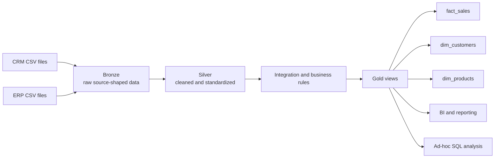

# SQL Server End-to-End Data Warehouse


> A layered SQL Server data warehouse that integrates CRM and ERP sales data, cleans and standardizes it, and exposes business-ready views (star schema) for analytics and reporting.

## Table of Contents

- [Overview](#overview)
- [Project Objectives](#project-objectives)
- [Architecture](#architecture)
- [Data Flow and Integration](#data-flow-and-integration)
- [Gold Data Model](#gold-data-model)
- [Data Quality Checks](#data-quality-checks)
- [Technology Stack](#technology-stack)
- [Repository Structure](#repository-structure)
- [Setup and Run](#setup-and-run)
- [Sample Analytics Queries](#sample-analytics-queries)
- [Naming Conventions](#naming-conventions)
- [Limitations](#limitations)
- [Future Improvements](#future-improvements)
- [What I Learned](#what-i-learned)
- [Acknowledgments](#acknowledgments)
- [Author](#author)

## Overview

This project demonstrates an end-to-end data warehouse workflow using a **Medallion architecture**. CSV files from CRM and ERP source systems are loaded into a **Bronze** layer, cleaned and integrated in **Silver**, then shaped into business-facing objects in **Gold**.

The Gold layer provides customer and product dimensions and a sales fact table, so analysts can query a single consistent model instead of joining raw operational tables.

## Project Objectives

- Consolidate sales data from two source systems (CRM and ERP) into one analytical model.
- Resolve data quality issues: duplicates, nulls, inconsistent formats, and invalid dates.
- Provide a clean star schema that is easy to use for BI tools and ad-hoc SQL.
- Document the data catalog, lineage, and naming conventions clearly.

## Architecture



### Medallion Layers

| Layer | Purpose | Objects and processing |
|---|---|---|
| **Bronze** | Keep source data raw and traceable. | Tables with source names and data as-is. Batch full load (truncate and insert). No transformations. |
| **Silver** | Prepare data for analysis. | Tables with source-oriented names. Cleansing, standardization, normalization, derived columns, and enrichment. Full load (truncate and insert). |
| **Gold** | Business-ready data for reporting. | Views with data integration, aggregations, and business logic. Star schema: `dim_customers`, `dim_products`, `fact_sales`. |

## Data Flow and Integration

Sources are CRM and ERP CSV files read from folders. Integration happens in the Gold layer, where sales, customer, and product information are combined into a star schema.

### Data Lineage

| Source | Bronze / Silver objects |
|---|---|
| CRM | `crm_sales_details`, `crm_cust_info`, `crm_prd_info` |
| ERP | `erp_cust_az12`, `erp_loc_a101`, `erp_px_cat_g1v2` |
| Gold output | `fact_sales`, `dim_customers`, `dim_products` |

## Gold Data Model

| Object | Role | Contents |
|---|---|---|
| `gold.dim_customers` | Customer dimension | Surrogate key, customer identifiers, names, country, marital status, gender, birthdate, source creation date. |
| `gold.dim_products` | Product dimension | Surrogate key, product identifiers and attributes, category hierarchy, maintenance flag, cost, product line, start date. |
| `gold.fact_sales` | Sales fact | Order number, customer and product surrogate keys, order/shipping/due dates, sales amount, quantity, price. |

**Relationships:** `fact_sales.customer_key → dim_customers.customer_key` and `fact_sales.product_key → dim_products.product_key`.

> Fact table grain: one row per order line (verify against your SQL before publishing).

## Data Quality Checks

Typical checks applied during the Bronze → Silver step and validated before Gold:

- Remove duplicate records (keep the latest record per business key).
- Trim unwanted spaces in text fields.
- Standardize coded values (e.g., gender, marital status, country names) into readable values.
- Handle nulls and invalid or out-of-range dates.
- Validate that `sales = quantity × price` and fix inconsistent values.
- Check surrogate key uniqueness in dimensions and referential integrity between the fact and dimensions.

## Technology Stack

- **Database:** Microsoft SQL Server
- **Language:** T-SQL
- **Source format:** CSV files
- **Modeling:** Medallion architecture + star schema
- **Consumers:** BI and reporting, ad-hoc SQL analysis

## Repository Structure

```text
sql-data-warehouse-project/
├── datasets/        # CRM and ERP source CSV files
├── docs/            # Architecture, data flow, data catalog, naming conventions
├── scripts/
│   ├── init_database.sql
│   ├── bronze/      # DDL + load_bronze procedure
│   ├── silver/      # DDL + load_silver procedure
│   └── gold/        # Views: dim_customers, dim_products, fact_sales
├── tests/           # Data quality checks
└── README.md
```

> Adjust folder and file names to match your actual repository.

## Setup and Run

1. **Prerequisites:** SQL Server (Express or Developer) and SQL Server Management Studio (SSMS) or Azure Data Studio.
2. **Clone the repository:**
   ```bash
   git clone https://github.com/ahmedaliy01/sql-data-warehouse-project.git
   ```
3. **Configure source files:** place the CRM and ERP CSV files in a local folder and update the file paths inside the Bronze load script. Never commit credentials.
4. **Create the database and schemas:** run `scripts/init_database.sql` (creates the `bronze`, `silver`, and `gold` schemas).
5. **Load Bronze:**
   ```sql
   EXEC bronze.load_bronze;
   ```
6. **Build Silver:**
   ```sql
   EXEC silver.load_silver;
   ```
7. **Create Gold views:** run the scripts in `scripts/gold/`.
8. **Validate:** run the quality checks in `tests/` and a sample query such as:
   ```sql
   SELECT COUNT(*) FROM gold.fact_sales;
   ```

## Sample Analytics Queries

Examples you can run on the Gold layer (confirm column names against your views):

```sql
-- Total sales by country
SELECT c.country, SUM(f.sales_amount) AS total_sales
FROM gold.fact_sales f
JOIN gold.dim_customers c ON f.customer_key = c.customer_key
GROUP BY c.country
ORDER BY total_sales DESC;

-- Top 10 products by revenue
SELECT TOP 10 p.product_name, SUM(f.sales_amount) AS revenue
FROM gold.fact_sales f
JOIN gold.dim_products p ON f.product_key = p.product_key
GROUP BY p.product_name
ORDER BY revenue DESC;

-- Monthly sales trend
SELECT FORMAT(f.order_date, 'yyyy-MM') AS order_month,
       SUM(f.sales_amount) AS total_sales
FROM gold.fact_sales f
GROUP BY FORMAT(f.order_date, 'yyyy-MM')
ORDER BY order_month;
```

## Naming Conventions

Names use lowercase English `snake_case`. Avoid SQL reserved words.

| Object | Convention | Example |
|---|---|---|
| Bronze / Silver table | `<source_system>_<source_entity>` | `crm_cust_info` |
| Gold dimension | `dim_<business_entity>` | `dim_customers` |
| Gold fact | `fact_<business_process>` | `fact_sales` |
| Gold report object | `report_<subject>` | `report_sales_monthly` |
| Surrogate key | `<entity>_key` | `customer_key` |
| Technical metadata column | `dwh_<purpose>` | `dwh_create_date` |
| Load procedure | `load_<layer>` | `load_bronze`, `load_silver` |

## Limitations

- Full loads only (truncate and insert); no incremental loading yet.
- No orchestration or scheduling.
- Performance tuning, indexing strategy, and access control are not covered.

## Future Improvements

- Add incremental loading and logging for each load run.
- Schedule the pipeline (SQL Server Agent, Azure Data Factory, or similar).
- Automate data quality tests and report results.
- Build a Power BI dashboard on top of the Gold layer.
- Add a project-owned architecture diagram and screenshots of query results.

## What I Learned

<!-- Write 3-4 short bullets in your own words, for example: -->
- Designing a Medallion architecture and separating raw, cleaned, and business layers.
- Writing T-SQL stored procedures for repeatable batch loads.
- Integrating two source systems and building a star schema.
- Finding and fixing data quality issues before analytics.

## Acknowledgments

Built by following the SQL data warehouse tutorial by **Baraa (Data With Baraa)**. Architecture, data catalog, and naming conventions are based on his materials.

- Tutorial: https://youtu.be/9GVqKuTVANE
- Original repository: https://github.com/DataWithBaraa/sql-data-warehouse-project

## Author

**Ahmed Ali Ahmed**
Computer Engineering student, Pharos University in Alexandria | DEPI Microsoft Data Engineer track

[](https://github.com/ahmedaliy01)
[](https://www.linkedin.com/in/ahmedaliy/)
