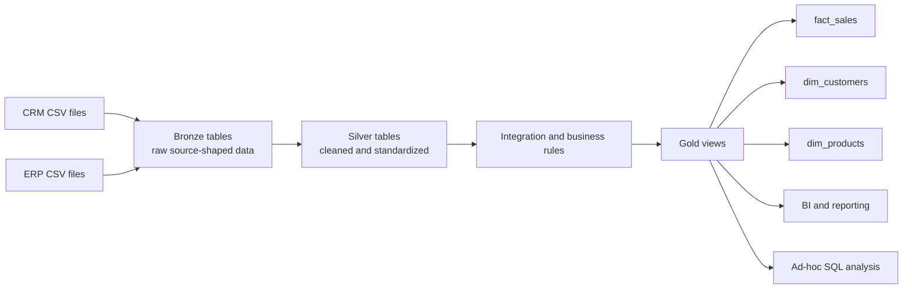

# SQL Server End-to-End Data Warehouse

> A layered SQL Server data warehouse that brings CRM and ERP sales data together, standardizes it, and presents business-ready views for analytics.

<!-- Before publishing: replace the bracketed items with facts from your repository. -->

## Overview

This project demonstrates an end-to-end data warehouse workflow using a Medallion-style architecture. CSV files from CRM and ERP source systems are loaded into a Bronze layer, prepared and integrated in Silver, then shaped into business-facing objects in Gold. The Gold layer described in the project material includes customer and product dimensions and a sales fact table.

The project is intended to show how data integration connects operational source data to a consistent analytical model. The supplied materials describe the architecture and naming conventions; the exact repository layout, scripts, environment requirements, and personal adaptations still need to be filled in from the implementation.

## Architecture

The source architecture and flow diagrams supplied with the project were used as reference material. This README uses an original Mermaid diagram to summarize their documented flow.



### Medallion layers

| Layer | Purpose | Documented objects and processing |
|---|---|---|
| **Bronze** | Preserve source data in a traceable, raw form. | Tables that retain source names and data as-is; batch full loads using truncate and insert; no transformations. |
| **Silver** | Prepare source data for analysis. | Tables retaining source-oriented names; documented transformations include cleansing, standardization, normalization, derived columns, and enrichment. Full load using truncate and insert. |
| **Gold** | Present business-ready data for reporting and analytics. | Views; data integration, aggregations, and business logic; documented models include a star schema, flat tables, and aggregated tables. The supplied catalog names `dim_customers`, `dim_products`, and `fact_sales`. |

The layer descriptions above summarize the supplied architecture and data-layer documentation. Confirm that each listed transformation and object is present in the published implementation before treating it as a completed feature.

## Data flow and integration

The documented sources are CRM and ERP CSV files accessed from folders. The flow diagram shows source-shaped Bronze and Silver objects feeding Gold business objects. The Gold model combines sales, customer, and product information so analysis can use a sales fact with customer and product dimensions.

The data-layer notes describe integration as a Gold-layer activity, alongside aggregation and business rules. The precise join keys, transformation rules, load order, error handling, and validation checks are not specified in the supplied materials and should be documented from the SQL scripts.

### Data lineage shown in the supplied flow

| Source / layer | Objects shown |
|---|---|
| CRM to Bronze | `crm_sales_details`, `crm_cust_info`, `crm_prd_info` |
| ERP to Bronze | `erp_cust_az12`, `erp_loc_a101`, `erp_px_cat_g1v2` |
| Bronze to Silver | Same source-oriented object names are shown across the layers. |
| Silver to Gold | Inputs feed `fact_sales`, `dim_customers`, and `dim_products`. |

Object names and lineage in this table are transcribed from the supplied flow diagram. Check them against the project code before publishing if the implementation differs.

## Gold data model

The supplied data catalog defines these Gold objects:

| Object | Role | Documented contents |
|---|---|---|
| `gold.dim_customers` | Customer dimension | Surrogate key, customer identifiers, names, country, marital status, gender, birthdate, and source creation date. |
| `gold.dim_products` | Product dimension | Surrogate key, product identifiers and descriptive attributes, category hierarchy, maintenance flag, cost, product line, and start date. |
| `gold.fact_sales` | Sales fact | Order number, customer and product surrogate keys, order/shipping/due dates, sales amount, quantity, and price. |

The catalog is the source for these object and column descriptions. Confirm actual SQL data types, keys, grain, and constraints against the implementation. In particular, document the fact table grain (for example, what one row represents) only after verifying it in the SQL.

## Technology stack

- **Database:** Microsoft SQL Server
- **Query and transformation language:** T-SQL (confirm against repository scripts)
- **Source format and interface:** CSV files in folders
- **Modeling approach:** Medallion layers; Gold documentation describes a star schema as well as flat and aggregated objects
- **Downstream use cases:** BI and reporting, ad-hoc SQL analysis; machine learning is shown as a possible consumer in the architecture reference

<!-- Add exact SQL Server edition/version, client tools, orchestration, and BI tools only when verified. -->

## Repository structure

The repository tree was not included with the supplied documentation. Replace this section with the actual structure; do not publish this illustrative block as a verified tree.

```text
<repository-root>/
├── <SQL scripts and/or database project>
├── <source data or instructions for obtaining it>
├── <documentation and diagrams>
└── README.md
```

## Setup and run

Exact setup commands and script names were not supplied. Fill in the steps below from the repository and verify them on a clean SQL Server instance before publishing.

1. **Prerequisites:** [SQL Server edition/version, required tools, and permissions]
2. **Get the project:** [repository URL or clone instructions]
3. **Configure source files:** [expected folder paths and CSV filenames; do not commit credentials]
4. **Create database and schemas:** [verified script or instructions]
5. **Load Bronze:** [verified command/script and expected result]
6. **Build Silver:** [verified command/script and expected result]
7. **Create or refresh Gold:** [verified command/script and expected result]
8. **Validate:** [documented checks and sample query]

> Do not run these steps until the bracketed instructions have been replaced with the actual project commands and paths.

## Naming conventions

Names use lowercase English `snake_case`, with underscores between words. Avoid SQL reserved words.

| Object | Convention | Example |
|---|---|---|
| Bronze table | `<source_system>_<source_entity>`; retain the source entity name. | `crm_customer_info` |
| Silver table | `<source_system>_<source_entity>`; retain the source-oriented name. | `erp_loc_a101` |
| Gold dimension | `dim_<business_entity>` | `dim_customers` |
| Gold fact | `fact_<business_process>` | `fact_sales` |
| Gold report object | `report_<subject>` | `report_sales_monthly` |
| Dimension surrogate key | `<entity>_key` | `customer_key` |
| Technical metadata column | `dwh_<purpose>` | `dwh_create_date` |
| Layer load procedure | `load_<layer>` | `load_bronze`, `load_silver` |

The supplied architecture shows Gold views and says Gold has no load. The procedure naming document gives a general `load_<layer>` pattern; confirm whether a Gold procedure actually exists before listing one as part of this project.

## Screenshots and diagrams

The supplied `data_architecture.png` and `data_flow.png` include Data with Baraa branding. They are treated as reference material and are not embedded here. The Mermaid diagram above is a fresh summary based on the documented architecture. Replace or supplement it with screenshots from your own SQL Server implementation, query results, or a diagram you created and have permission to share.

Suggested additions:

- Your own overview of the SQL Server database and schemas.
- A query result showing the Gold objects and representative rows.
- Your own data-flow or model diagram, checked against the implemented scripts.

## Limitations and documentation gaps

- The supplied material does not include the repository tree, exact setup commands, SQL Server version, or orchestration details.
- Join logic, load dependencies, failure handling, data quality checks, and the sales fact grain need confirmation from the implementation.
- The data catalog gives business descriptions but should be checked against the actual schema and SQL types.
- Incremental loading, security configuration, deployment, and performance results are not established by the supplied documents.
- The project reference diagrams describe possible downstream consumers. Confirm which consumers were actually implemented.

## Acknowledgments and attribution

The architecture, data-layer, data-flow, and naming-convention materials were supplied as documentation from Baraa's tutorial. This project README summarizes those materials as references. Add a link to the original tutorial and its author here: [tutorial / author link].

<!-- Add a short personal note here describing what you implemented, changed, or learned. -->

## Future improvements

Ideas to consider, not claims about current project features:

- Document verified setup and repeatable load instructions.
- Add automated data quality checks and record their expected outcomes.
- Define and document source-to-target mappings and Gold table grain.
- Add incremental loading if it fits the source data and project requirements.
- Add a project-owned architecture diagram and representative query examples.
- Document deployment, access control, and operational monitoring.

## Project ownership

**Author:** [ُAhmed Ali]  
**Tutorial/reference:** [https://youtu.be/9GVqKuTVANE?si=CD7F8udOJRQfLJoe]  
**Repository:** [https://github.com/DataWithBaraa/sql-data-warehouse-project]

<!-- Review all bracketed text and remove this note before publishing. -->
